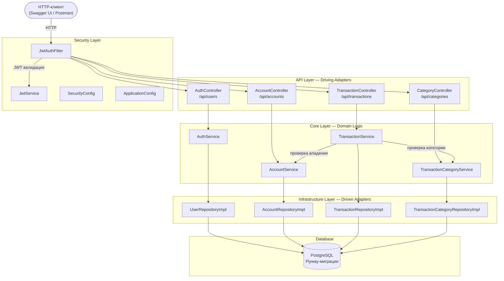

# Finance Tracker API

## Описание проекта

**Finance Tracker** — RESTful API-сервис для персонального учёта финансов. Приложение позволяет пользователям вести учёт доходов и расходов по нескольким финансовым счетам с категоризацией транзакций.

### Назначение

Система предоставляет централизованный инструмент для:
- отслеживания денежных потоков по нескольким счетам (карты, наличные);
- категоризации расходов и доходов;
- контроля текущего баланса в реальном времени;
- безопасного доступа к данным через JWT-аутентификацию.

### Целевые пользователи

Физические лица, желающие вести структурированный учёт доходов и расходов по нескольким финансовым счетам с категоризацией операций.

---

## Стек технологий

| Компонент | Технология | Версия |
|-----------|------------|--------|
| Язык программирования | Java | 25 |
| Фреймворк | Spring Boot | 4.0.6 |
| Безопасность | Spring Security + JWT (jjwt) | jjwt 0.13.0 |
| ORM | Spring Data JPA (Hibernate) | — |
| СУБД | PostgreSQL | 18.4 |
| Миграции БД | Flyway | — |
| Документация API | SpringDoc OpenAPI (Swagger UI) | 3.0.2 |
| Сборка | Maven (Maven Wrapper) | 3.9+ |
| Контейнеризация | Docker Compose | — |
| Утилиты | Lombok | — |

---

## Архитектура

Проект построен на основе **гексагональной архитектуры** (порты и адаптеры) с модульной организацией по доменным областям.

### Схема основных компонентов и связей



### Структура пакетов

```
com.financetracker
├── user/                          # Модуль пользователей и аутентификации
│   ├── api/web/                   # Контроллеры, DTO (driving adapter)
│   ├── api/config/                # Конфигурация публичных маршрутов
│   ├── core/model/                # Доменные сущности (User)
│   ├── core/service/              # Бизнес-логика, порты (AuthService, UserRepository)
│   └── infrastructure/            # JPA-репозитории, Spring Security адаптеры
│
├── account/                       # Модуль финансовых счетов
│   ├── api/web/                   # Контроллеры, DTO
│   ├── core/model/                # Доменные сущности (Account, AccountType)
│   ├── core/service/              # Бизнес-логика, порты
│   └── infrastructure/            # JPA-репозитории
│
├── transaction/                   # Модуль транзакций и категорий
│   ├── api/web/                   # Контроллеры, DTO
│   ├── core/model/                # Доменные сущности (Transaction, TransactionCategory, TransactionType)
│   ├── core/service/              # Бизнес-логика, порты
│   └── infrastructure/            # JPA-репозитории
│
└── shared/                        # Сквозная функциональность
    ├── api/advice/                # Глобальная обработка ошибок (RFC 7807)
    ├── api/annotation/            # Аннотация @CurrentUserId
    ├── api/config/                # Интерфейс PublicRouteProvider
    ├── api/web/                   # Резолвер аргументов контроллеров
    ├── core/exception/            # Доменные исключения
    ├── infrastructure/config/     # OpenAPI конфигурация
    ├── infrastructure/security/   # JWT-фильтр, SecurityConfig, BCrypt
    └── infrastructure/web/        # WebMvc конфигурация
```

---

## Перечень модулей

| Модуль | Пакет | Ответственность |
|--------|-------|-----------------|
| **User** | `com.financetracker.user` | Регистрация и аутентификация пользователей, генерация JWT-токенов. Доменная модель `User`, сервис `AuthService`, порт `TokenProvider`. |
| **Account** | `com.financetracker.account` | Создание и управление финансовыми счетами (типы: CARD, CASH). Проверка владения счётом, атомарная корректировка баланса. |
| **Transaction** | `com.financetracker.transaction` | Запись транзакций (INCOME/EXPENSE) с привязкой к счёту и категории. Атомарное обновление баланса. Управление пользовательскими и системными категориями. |
| **Shared** | `com.financetracker.shared` | Глобальная обработка исключений в формате RFC 7807, JWT-аутентификация (фильтр, сервис), конфигурация Spring Security, аннотация `@CurrentUserId` для извлечения ID пользователя из токена, OpenAPI/Swagger конфигурация. |

---

## Точки интеграции

| Точка интеграции | Тип | Описание |
|-----------------|-----|----------|
| **PostgreSQL** | СУБД | Основное хранилище данных. Подключение через JDBC (`spring.datasource`), параметры из файла `.env`. Таблицы: `app_user`, `account`, `category`, `transaction`, `budget`. |
| **Flyway** | Миграции БД | Версионное управление схемой БД. 2 миграции: `V1__init_schema.sql` (начальная схема), `V2__update_category_and_transaction.sql` (пользовательские категории, описание транзакций). |
| **Docker Compose** | Контейнеризация | Развёртывание PostgreSQL (`postgres:18.4-alpine`) в контейнере `finance-tracker-db`. Порт 5432, volume `postgres_data`. |
| **Swagger UI** | Документация | Интерактивная документация API по адресу `/swagger-ui.html`. OpenAPI-спецификация доступна по `/v3/api-docs`. Публичный доступ без аутентификации. |
| **Файловая система** | Конфигурация | Файл `.env` с параметрами подключения к БД (DB_USERNAME, DB_PASSWORD, DB_NAME). Импортируется через `spring.config.import: optional:file:.env[.properties]`. |

---

## Инструкция по сборке и запуску

### Предварительные требования

- **Java 25+** (JDK)
- **Docker** и **Docker Compose**
- Git

> Maven устанавливать не нужно — проект включает Maven Wrapper.

### Шаги запуска

1. **Клонировать репозиторий:**
   ```bash
   git clone https://github.com/meineac/finance-tracker.git
   cd finance-tracker
   ```

2. **Создать файл конфигурации `.env`:**
   ```bash
   cp .env.example .env
   ```
   Содержимое `.env.example`:
   ```properties
   DB_USERNAME=dev_user
   DB_PASSWORD=dev_password
   DB_NAME=finance-tracker-dev-db
   ```

3. **Запустить PostgreSQL:**
   ```bash
   docker compose up -d
   ```

4. **Собрать и запустить приложение:**
   ```bash
   ./mvnw spring-boot:run
   ```
   На Windows:
   ```cmd
   mvnw.cmd spring-boot:run
   ```

5. **Открыть документацию API:**
   - Swagger UI: [http://localhost:8080/swagger-ui.html](http://localhost:8080/swagger-ui.html)
   - OpenAPI JSON: [http://localhost:8080/v3/api-docs](http://localhost:8080/v3/api-docs)

### Запуск тестов

```bash
./mvnw test
```

---

## API Endpoints

| Метод | Эндпоинт | Описание | Аутентификация |
|-------|----------|----------|----------------|
| POST | `/api/users/register` | Регистрация нового пользователя | Нет |
| POST | `/api/users/login` | Вход в систему, получение JWT | Нет |
| POST | `/api/accounts` | Создание финансового счёта | Да |
| GET | `/api/accounts` | Список счетов пользователя | Да |
| POST | `/api/transactions` | Создание транзакции | Да |
| GET | `/api/transactions/account/{id}` | Транзакции по счёту | Да |
| POST | `/api/categories` | Создание категории | Да |
| GET | `/api/categories` | Список категорий пользователя | Да |

Все защищённые эндпоинты требуют заголовок `Authorization: Bearer <JWT-токен>`.

---

## Документация

- [Спецификация требований](docs/requirements.md) — бизнес, пользовательские, функциональные и нефункциональные требования
- [Верификация требований](docs/verification.md) — способы проверки и результаты верификации
- [Реестр дефектов](ISSUES.md) — обнаруженные расхождения между требованиями и реализацией
