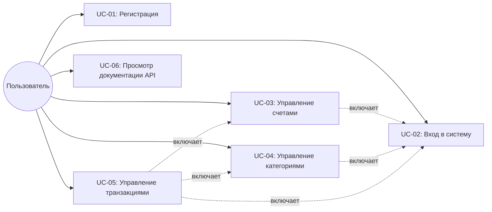
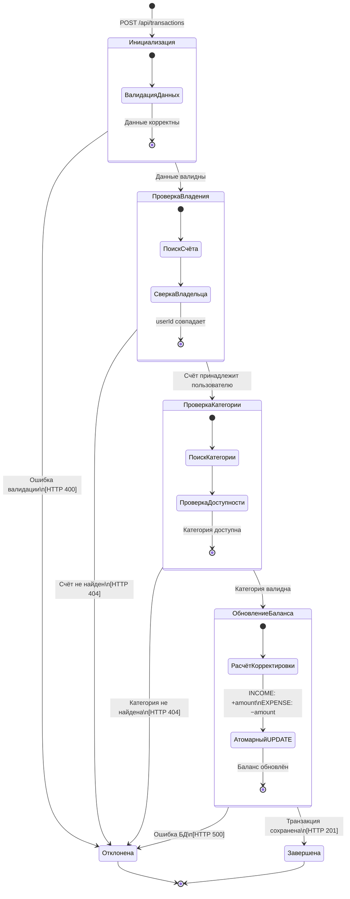

# Спецификация требований — Finance Tracker API

## 1. Бизнес-требования

### 1.1. Назначение системы

Finance Tracker — RESTful API-сервис для персонального учёта финансов. Система предоставляет пользователям инструмент для контроля доходов и расходов по нескольким финансовым счетам с категоризацией транзакций.

### 1.2. Решаемая проблема

Физические лица часто ведут учёт финансов в разрозненных таблицах или не ведут вовсе, что приводит к потере контроля над расходами. Finance Tracker решает эту проблему, предоставляя:
- централизованный учёт денежных потоков по нескольким счетам;
- категоризацию расходов и доходов;
- контроль текущего баланса в реальном времени;
- безопасный доступ к данным через аутентификацию.

### 1.3. Цели

| ID | Цель | Метрика успеха |
|----|------|----------------|
| BG-01 | Обеспечить безопасный доступ к финансовым данным | JWT-аутентификация, изоляция данных пользователей |
| BG-02 | Поддержать многосчётность | Пользователь может создать неограниченное число счетов типов CARD и CASH |
| BG-03 | Обеспечить гибкую категоризацию | Поддержка пользовательских и системных категорий |
| BG-04 | Гарантировать целостность финансовых данных | Атомарные операции при записи транзакций |
| BG-05 | Предоставить документируемый API | Автогенерируемая OpenAPI-спецификация с Swagger UI |

---

## 2. Пользовательские требования

### Use Case диаграмма

---

### UC-01: Регистрация нового пользователя

| Поле | Значение |
|------|----------|
| **Актор** | Незарегистрированный пользователь |
| **Предусловия** | Пользователь не зарегистрирован в системе |
| **Триггер** | Пользователь отправляет POST `/api/users/register` |

**Основной сценарий:**
1. Пользователь отправляет запрос с email, паролем и полным именем.
2. Система проверяет валидность данных (формат email, длина пароля ≥ 6 символов, непустое имя).
3. Система проверяет, что email не зарегистрирован.
4. Система хеширует пароль с помощью BCrypt.
5. Система сохраняет нового пользователя в базе данных.
6. Система автоматически выполняет вход и возвращает JWT-токен (HTTP 201).

**Альтернативные сценарии:**
- **2a.** Данные невалидны → система возвращает HTTP 400 с описанием ошибок валидации.
- **3a.** Email уже зарегистрирован → система возвращает HTTP 409 Conflict с сообщением "Email is already registered".

**Постусловия:** Пользователь зарегистрирован и имеет валидный JWT-токен для доступа к API.

---

### UC-02: Вход в систему

| Поле | Значение |
|------|----------|
| **Актор** | Зарегистрированный пользователь |
| **Предусловия** | Пользователь зарегистрирован в системе |
| **Триггер** | Пользователь отправляет POST `/api/users/login` |

**Основной сценарий:**
1. Пользователь отправляет запрос с email и паролем.
2. Система проверяет валидность данных.
3. Система находит пользователя по email.
4. Система проверяет совпадение пароля с хешем.
5. Система генерирует JWT-токен и возвращает его (HTTP 200).

**Альтернативные сценарии:**
- **2a.** Данные невалидны → HTTP 400.
- **3a.** Пользователь не найден → HTTP 403 "Invalid credentials".
- **4a.** Пароль не совпадает → HTTP 403 "Invalid credentials".

**Постусловия:** Пользователь имеет валидный JWT-токен со сроком действия 24 часа.

---

### UC-03: Управление счетами

| Поле | Значение |
|------|----------|
| **Актор** | Аутентифицированный пользователь |
| **Предусловия** | Пользователь аутентифицирован (имеет валидный JWT-токен) |
| **Триггер** | Пользователь отправляет запрос к `/api/accounts` |

**Основной сценарий (создание счёта):**
1. Пользователь отправляет POST `/api/accounts` с именем счёта и типом (CARD/CASH).
2. Система проверяет валидность данных.
3. Система создаёт счёт с начальным балансом 0.00.
4. Система возвращает созданный счёт (HTTP 201).

**Основной сценарий (просмотр счетов):**
1. Пользователь отправляет GET `/api/accounts`.
2. Система возвращает список всех счетов пользователя (HTTP 200).

**Альтернативные сценарии:**
- **Создание, 2a.** Данные невалидны → HTTP 400.
- **Общее.** Токен невалиден или истёк → HTTP 401.

**Постусловия:** Счёт создан и доступен пользователю; баланс равен 0.00.

---

### UC-04: Управление категориями транзакций

| Поле | Значение |
|------|----------|
| **Актор** | Аутентифицированный пользователь |
| **Предусловия** | Пользователь аутентифицирован |
| **Триггер** | Пользователь отправляет запрос к `/api/categories` |

**Основной сценарий (создание категории):**
1. Пользователь отправляет POST `/api/categories` с именем категории.
2. Система проверяет, что категория с таким именем не существует у пользователя (регистронезависимо).
3. Система создаёт пользовательскую категорию.
4. Система возвращает созданную категорию (HTTP 201).

**Основной сценарий (просмотр категорий):**
1. Пользователь отправляет GET `/api/categories`.
2. Система возвращает все видимые категории: пользовательские + системные (HTTP 200).

**Альтернативные сценарии:**
- **2a.** Категория с таким именем уже существует → HTTP 409 Conflict.
- **Общее.** Имя категории пустое → HTTP 400.

**Постусловия:** Категория создана и доступна для привязки к транзакциям.

---

### UC-05: Управление транзакциями

| Поле | Значение |
|------|----------|
| **Актор** | Аутентифицированный пользователь |
| **Предусловия** | Пользователь аутентифицирован, имеет хотя бы один счёт и одну категорию |
| **Триггер** | Пользователь отправляет запрос к `/api/transactions` |

**Основной сценарий (создание транзакции):**
1. Пользователь отправляет POST `/api/transactions` с ID счёта, ID категории, типом (INCOME/EXPENSE), суммой и описанием.
2. Система проверяет валидность данных (сумма > 0, обязательные поля заполнены).
3. Система проверяет, что счёт принадлежит пользователю.
4. Система проверяет, что категория существует и доступна пользователю.
5. Система рассчитывает корректировку баланса: +amount для INCOME, −amount для EXPENSE.
6. Система атомарно обновляет баланс счёта.
7. Система сохраняет транзакцию с текущей временной меткой.
8. Система возвращает созданную транзакцию (HTTP 201).

**Основной сценарий (просмотр транзакций по счёту):**
1. Пользователь отправляет GET `/api/transactions/account/{accountId}`.
2. Система проверяет, что счёт принадлежит пользователю.
3. Система возвращает транзакции, отсортированные по дате убывания (HTTP 200).

**Альтернативные сценарии:**
- **2a.** Данные невалидны → HTTP 400.
- **3a.** Счёт не принадлежит пользователю → HTTP 404 "Account not found".
- **4a.** Категория не найдена → HTTP 404 "Category not found".

**Постусловия:** Транзакция сохранена, баланс счёта обновлён.

---

### UC-06: Просмотр документации API

| Поле | Значение |
|------|----------|
| **Актор** | Любой пользователь (аутентификация не требуется) |
| **Предусловия** | Приложение запущено |
| **Триггер** | Пользователь открывает `/swagger-ui.html` |

**Основной сценарий:**
1. Пользователь открывает Swagger UI в браузере.
2. Система отображает интерактивную документацию всех API-эндпоинтов.
3. Пользователь может отправлять тестовые запросы через Swagger UI.

**Постусловия:** Пользователь ознакомлен с доступными API-эндпоинтами.

---

## 3. Функциональные требования

### Модуль аутентификации

| ID | Требование |
|----|------------|
| FR-01 | Система должна позволять регистрацию пользователя с указанием email, пароля (не менее 6 символов) и полного имени. Все поля обязательны. |
| FR-02 | Система должна проверять уникальность email при регистрации и возвращать HTTP 409 при попытке повторной регистрации. |
| FR-03 | Система должна хешировать пароль пользователя с помощью алгоритма BCrypt перед сохранением в базу данных. |
| FR-04 | При успешной регистрации система должна автоматически выполнить вход и вернуть JWT-токен в теле ответа со статусом HTTP 201. |
| FR-05 | Система должна аутентифицировать пользователя по email и паролю, возвращая JWT-токен в теле ответа со статусом HTTP 200. |
| FR-06 | JWT-токен должен содержать email пользователя в поле subject и иметь срок действия 24 часа (86400000 мс). |

### Модуль счетов

| ID | Требование |
|----|------------|
| FR-07 | Система должна позволять аутентифицированному пользователю создавать финансовый счёт с указанием имени и типа (CARD или CASH). |
| FR-08 | Каждый новый счёт должен создаваться с начальным балансом 0.00. |
| FR-09 | Система должна возвращать список всех счетов аутентифицированного пользователя по запросу GET `/api/accounts`. |

### Модуль категорий

| ID | Требование |
|----|------------|
| FR-10 | Система должна позволять аутентифицированному пользователю создавать пользовательские категории транзакций с указанием имени. |
| FR-11 | Имена категорий должны быть уникальны в пределах одного пользователя. Проверка уникальности выполняется без учёта регистра. |
| FR-12 | При запросе списка категорий система должна возвращать как пользовательские категории, так и системные (глобальные, где `user_id IS NULL`). |

### Модуль транзакций

| ID | Требование |
|----|------------|
| FR-13 | Система должна позволять создание транзакций двух типов: INCOME (доход) и EXPENSE (расход). Сумма транзакции должна быть строго положительной. |
| FR-14 | При создании транзакции типа INCOME баланс указанного счёта должен увеличиваться на сумму транзакции. При создании транзакции типа EXPENSE — уменьшаться. |
| FR-15 | Корректировка баланса счёта при создании транзакции должна выполняться атомарно — одним SQL-запросом UPDATE с выражением `SET balance = balance + :amount`. |
| FR-16 | Система должна возвращать список транзакций по конкретному счёту, отсортированный по дате совершения в порядке убывания (новые сначала). |

### Общие требования

| ID | Требование |
|----|------------|
| FR-17 | Пользователь должен иметь доступ только к своим ресурсам (счетам, транзакциям, категориям). Попытка доступа к чужому ресурсу должна возвращать HTTP 404. |
| FR-18 | Все ошибки API должны возвращаться в формате RFC 7807 ProblemDetail с полями `type`, `title`, `status`, `detail`. |

---

## 4. Нефункциональные требования

| ID | Категория | Требование |
|----|-----------|------------|
| NFR-01 | Безопасность | Аутентификация должна быть stateless — без использования серверных HTTP-сессий. Каждый запрос аутентифицируется через JWT-токен в заголовке Authorization. |
| NFR-02 | Производительность | Время ответа API для типовых CRUD-операций не должно превышать 500 мс при нагрузке до 100 одновременных пользователей. |
| NFR-03 | Безопасность | Пароли пользователей не должны храниться в базе данных в открытом виде. Должен использоваться алгоритм BCrypt. |
| NFR-04 | Сопровождаемость | Схема базы данных должна управляться через версионные миграции Flyway. Ручное изменение схемы в production запрещено. |
| NFR-05 | Документируемость | API должен быть автоматически документирован через OpenAPI 3.0 с интерактивным интерфейсом Swagger UI, доступным без аутентификации. |
| NFR-06 | Переносимость | Приложение должно собираться и запускаться через Maven Wrapper (`./mvnw`) без предустановки Maven на целевой машине. |
| NFR-07 | Развёртываемость | База данных PostgreSQL должна разворачиваться одной командой `docker compose up -d` без дополнительной конфигурации. |

---

## 5. Диаграмма состояний сущности «Транзакция»

### Выбор сущности

Сущность **Transaction** (транзакция) имеет выраженный жизненный цикл: от инициализации запроса до успешного завершения или отклонения. Каждый переход сопровождается бизнес-проверками и побочными эффектами (обновление баланса).

### Диаграмма состояний

### Описание состояний

| Состояние | Описание |
|-----------|----------|
| **Инициализация** | Система получила HTTP-запрос и выполняет валидацию входных данных (`@Valid`: `accountId`, `categoryId`, `type`, `amount > 0`) |
| **ПроверкаВладения** | Система вызывает `accountService.validateOwnership(accountId, userId)` для проверки принадлежности счёта пользователю |
| **ПроверкаКатегории** | Система вызывает `transactionCategoryRepository.findByIdAndUserId(categoryId, userId)` для проверки существования и доступности категории |
| **ОбновлениеБаланса** | Система атомарно обновляет баланс: `UPDATE account SET balance = balance + :adjustment WHERE id = :accountId` |
| **Завершена** | Транзакция успешно сохранена в БД, баланс счёта обновлён, клиенту возвращён HTTP 201 |
| **Отклонена** | Транзакция отклонена на одном из этапов проверки. HTTP-код зависит от этапа: 400, 404 или 500 |

### Описание переходов

| Переход | Событие / Условие | Действие |
|---------|-------------------|----------|
| [*] → Инициализация | POST `/api/transactions` получен | Десериализация JSON, применение `@Valid` |
| Инициализация → ПроверкаВладения | Все поля валидны | — |
| Инициализация → Отклонена | `@Valid` обнаружил ошибки | Вернуть HTTP 400 с деталями |
| ПроверкаВладения → ПроверкаКатегории | `existsByIdAndUserId` == true | — |
| ПроверкаВладения → Отклонена | Счёт не найден | Бросить `ResourceNotFoundException` → HTTP 404 |
| ПроверкаКатегории → ОбновлениеБаланса | `findByIdAndUserId` вернул результат | — |
| ПроверкаКатегории → Отклонена | Категория не найдена | Бросить `ResourceNotFoundException` → HTTP 404 |
| ОбновлениеБаланса → Завершена | SQL UPDATE выполнен, транзакция сохранена | Вернуть `TransactionResponse` с HTTP 201 |
| ОбновлениеБаланса → Отклонена | Ошибка базы данных | Откат `@Transactional`, HTTP 500 |
