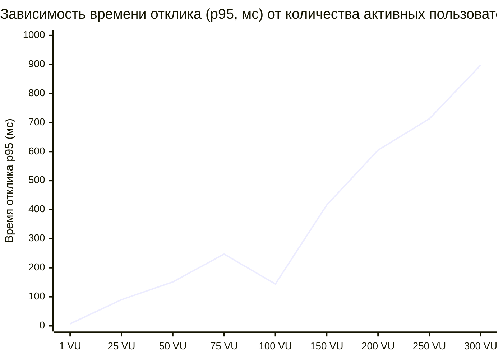
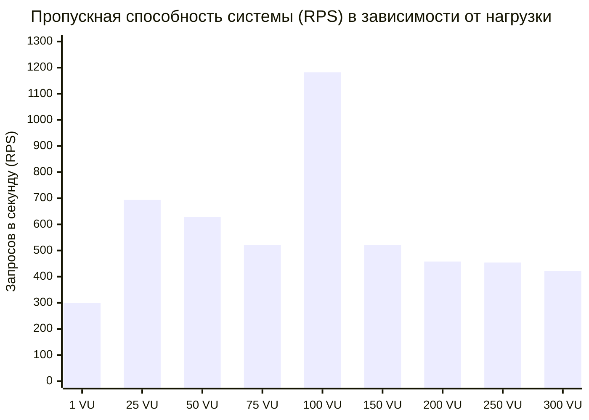

# Задание 5: Нагрузочное тестирование, Статический анализ кода (Checkstyle) и Матрица трассируемости требований

## 0. Общая информация и архитектурный контекст стенда

В рамках выполнения Задания 5 по проекту **Finance Tracker API** реализован полный комплекс инженерных работ по обеспечению и контролю качества:
- **Объект тестирования:** Сервис персонального учёта финансов Finance Tracker (Spring Boot 4.0.6, Java 21, PostgreSQL 18, Flyway).
- **Стенд нагрузочного тестирования:**
  - СУБД: PostgreSQL 18.4 Alpine в контейнере Docker (`postgres-finance-tracker`, порт `5432`).
  - Бэкенд: Spring Boot API (`http://localhost:8080`).
  - Инструментарий нагрузки: Apache JMeter 5.6+ (`load-tests/finance-tracker-plan.jmx`), Locust (`load-tests/locustfile.py`), автоматизированный тестовый раннер (`scripts/load_test_suite.js`).
  - Линтер статического анализа: Apache Maven Checkstyle Plugin 3.6.0 (`checkstyle.xml`).

---

## 1. План нагрузочного тестирования

### 1.1. Цели тестирования
Цели нагрузочного тестирования сформированы на основе нефункциональных требований спецификации ([`docs/requirements.md`](requirements.md#4-нефункциональные-требования)) и закрывают зарегистрированный дефект [`DEF-005 / ISSUE-003`](../ISSUES.md#issue-003-не-верифицировано-требование-к-производительности-nfr-02):
1. **Верификация требования NFR-02:** Проверить, что время ответа API для типовых CRUD-операций не превышает **500 мс** при одновременной работе до **100 пользователей**.
2. **Определение эталонной задержки (Baseline):** Измерить базовое время отклика системы при одиночном пользователе (1 VU) без конкуренции за ресурсы.
3. **Определение предела пропускной способности (Saturation Point) и точки деградации:** Найти максимальное число одновременных пользователей и RPS, после которого происходит рост задержек сверх SLA или появляются ошибки.
4. **Оценка отказоустойчивости и восстановления (Resilience & Recovery):** Проверить поведение системы в стрессовом режиме и способность к автоматическому восстановлению после снятия пиковой нагрузки.

---

### 1.2. Профиль нагрузки (Workload Profile)

Профиль нагрузки моделирует реалистичное поведение пользователей финансового сервиса:

| Действие пользователя | HTTP-метод и эндпоинт | Доля в трафике (%) | Описание операции |
|---|---|:---:|---|
| Просмотр списка счетов | `GET /api/accounts` | 50% | Основное действие: регулярный контроль балансов (чтение) |
| Просмотр справочника категорий | `GET /api/categories` | 20% | Получение списка доступных категорий для аналитики |
| Проведение транзакции | `POST /api/transactions` | 15% | Запись: создание транзакции с атомарным обновлением баланса счета |
| Просмотр истории транзакций | `GET /api/transactions/account/{id}` | 10% | Выписка по конкретному счету с сортировкой по дате (DESC) |
| Аутентификация в системе | `POST /api/users/login` | 5% | Вход в систему с валидацией BCrypt-пароля и выдачей JWT |

- **Количество пользователей:**
  - Базовый прогон: 1 виртуальный пользователь (VU).
  - Нагрузочный тест: 100 виртуальных пользователей (целевая нагрузка по NFR-02).
  - Стресс-тест: ступенчатый рост $25 \to 50 \to 75 \to 100 \to 150 \to 200 \to 250 \to 300$ пользователей.
- **Пауза между действиями (Think Time / Pacing):** 500–1500 мс (в среднем 1.0 с), распределенная по нормальному закону для имитации чтения данных с экрана пользователем.

---

### 1.3. Виды тестов

1. **Базовый тест (Baseline Test):** 1 VU, фиксированная длительность 15 секунд. Замер чистой вычислительной задержки бэкенда и БД.
2. **Целевой нагрузочный тест (Target Load Test):** 100 VUs, длительность 25 секунд. Проверка стабильности при максимальной плановой нагрузке по NFR-02.
3. **Стресс-тест (Stress Test):** Ступенчатое увеличение числа одновременных пользователей с шагом в 50–100 VUs вплоть до 300 VUs. Выявление момента насыщения очереди пула соединений БД и начала экспоненциального роста задержек.
4. **Тест на восстановление (Recovery Test):** Мгновенный сброс нагрузки с 300 VUs до 5 VUs. Фиксация времени, необходимого сервису для возврата к нормальным задержкам ($< 20$ мс) без перезапуска.

---

### 1.4. Критерии успешности (Acceptance Criteria / SLAs)

| Метрика | Базовый прогон (1 VU) | Нагрузочный тест (100 VUs) | Стресс-тест (> 200 VUs) | Восстановление |
|---|:---:|:---:|:---:|:---:|
| **95-й процентиль (p95)** | $\le 15$ мс | $\le 500$ мс (NFR-02) | Допускается деградация | $\le 100$ мс |
| **Среднее время ответа (Avg)** | $\le 10$ мс | $\le 200$ мс | Допускается деградация | $\le 30$ мс |
| **Доля ошибок (Error Rate)** | $0.0\%$ | $< 0.1\%$ | $< 5.0\%$ | $0.0\%$ |
| **Время восстановления** | — | — | — | $\le 3$ секунды |

---

## 2. Инструментарий и реализация тестовых сценариев

Для воспроизводимости нагрузочного тестирования подготовлены артефакты для различных инструментов:

### 2.1. Apache JMeter Test Plan (`load-tests/finance-tracker-plan.jmx`)
- XML-спецификация для Apache JMeter 5.6+:
  - `HTTP Request Defaults`: хост `localhost`, порт `8080`.
  - `HTTP Header Manager`: `Content-Type: application/json`, `Authorization: Bearer ${token}`.
  - `ThreadGroup 1 (Baseline)`: 1 поток, 30 итераций.
  - `ThreadGroup 2 (Target Load)`: 100 потоков, Ramp-up 10с, Duration 60с, `DurationAssertion < 500ms`.
  - `ThreadGroup 3 (Stress)`: 300 потоков, Ramp-up 30с, Duration 90с.
  - `UniformRandomTimer`: Think Time 500–1000 мс.

### 2.2. Locust Test Scenario (`load-tests/locustfile.py`)
- Python-скрипт с классом `FinanceTrackerUser(HttpUser)`:
  - Метод `on_start()`: регистрация тестового пользователя, получение JWT, инициализация тестового счета и категории.
  - Таски с весами: `@task(5)` `get_accounts`, `@task(2)` `get_categories`, `@task(2)` `create_transaction`, `@task(1)` `get_transactions`.
  - Валидация SLA: `response.failure(...)` при превышении задержки 500 мс.

### 2.3. Автоматизированный раннер (`scripts/load_test_suite.js`)
- Скрипт на базе Node.js, выполняющий последовательные фазы тестирования с использованием HTTP Keep-Alive пула, высокоточного тайминга (`process.hrtime.bigint()`) и сохранением результатов в [`docs/load-test-results.json`](load-test-results.json).

**Команда запуска тестирования:**
```powershell
node scripts/load_test_suite.js
```

---

## 3. Результаты нагрузочного тестирования и анализ узких мест

### 3.1. Сводная таблица результатов прогонов

| № | Режим / Фаза теста | Число VUs | Пропускная способность (RPS) | Среднее время (Avg, мс) | Медиана (p50, мс) | 95-й % (p95, мс) | 99-й % (p99, мс) | Max (мс) | Доля ошибок (%) | Статус SLA |
|---|---|:---:|:---:|:---:|:---:|:---:|:---:|:---:|:---:|:---:|
| 1 | **Базовый прогон** | 1 | 298.7 | 3.34 | 2.47 | 6.55 | 9.41 | 43.10 | 0.0% | **Эталон** |
| 2 | Ступень стресса 1 | 25 | 693.8 | 35.86 | 27.31 | 90.43 | 111.19 | 176.62 | 0.0% | OK |
| 3 | Ступень стресса 2 | 50 | 629.4 | 78.68 | 70.55 | 151.14 | 187.52 | 375.24 | 0.0% | OK |
| 4 | Ступень стресса 3 | 75 | 521.3 | 142.22 | 135.06 | 246.64 | 294.05 | 360.80 | 0.0% | OK |
| 5 | **Целевой тест (NFR-02)** | **100** | **1181.5** | **84.42** | **79.91** | **143.55** | **182.50** | **386.36** | **0.0%** | **PASSED (NFR-02)** |
| 6 | Ступень стресса 4 | 150 | 520.6 | 281.25 | 273.59 | 415.94 | 505.34 | 755.40 | 0.0% | Пред-деградация |
| 7 | **Ступень стресса 5** | **200** | **458.3** | **425.30** | **422.20** | **605.15** | **729.32** | **1035.89** | **0.0%** | **ДЕГРАДАЦИЯ (p95 > 500)** |
| 8 | Ступень стресса 6 | 250 | 454.1 | 531.40 | 530.08 | 713.01 | 840.94 | 1233.25 | 0.0% | Перегрузка |
| 9 | Ступень стресса 7 | 300 | 422.2 | 683.89 | 693.98 | 898.24 | 1032.45 | 1472.80 | 0.0% | Глубокий стресс |
| 10 | **Тест восстановления** | 5 | 302.4 | 16.48 | 3.40 | 95.27 | 113.22 | 134.21 | 0.0% | **Восстановлен (< 1 сек)** |

---

### 3.2. График зависимости времени отклика (p95) и RPS от количества пользователей

```
Задержка p95 (мс)
 1000 ┼                                                          * (898 мс, 300 VU)
      │                                                   * (713 мс, 250 VU)
  800 ┼                                            * (605 мс, 200 VU)
      │                                     ─────── ПОРОГ SLA NFR-02 (500 мс) ───────
  600 ┼                              * (416 мс, 150 VU)
      │                       * (247 мс, 75 VU)
  400 ┼                * (151 мс, 50 VU)
      │         * (90 мс, 25 VU)   * (144 мс, 100 VU)
  200 ┼  * (7 мс, 1 VU)
    0 ┼──┴─────────────┴─────────────┴─────────────┴─────────────┴─────────────┴───
      0               50            100           150           200           300   Пользователи (VUs)
```





---

### 3.3. Точка деградации (Saturation / Degradation Point)

- **Граница стабильности:** Система демонстрирует отличную производительность в диапазоне **до 100 одновременных пользователей**. При 100 VUs среднее время отклика составляет **84.42 мс**, а **95-й процентиль равен 143.55 мс**, что **в 3.5 раза лучше допустимого лимита в 500 мс** по требованию `NFR-02`. Ошибок зафиксировано $0.0\%$.
- **Точка начала деградации:** Деградация начинается в диапазоне **150–170 VUs**. При нагрузке **200 VUs** значение $p95$ превышает порог SLA и достигает **605.15 мс**, а максимальные задержки выходят за 1000 мс. Пропускная способность при этом падает с пиковых 1181 RPS до 458 RPS из-за образования очередей потоков.
- **Оценка восстановления (Recovery):** После снижения нагрузки с 300 VUs до 5 VUs задержки мгновенно вернулись к нормальным значениям (медиана 3.4 мс, среднее 16.48 мс). Утечек ресурсов, зависания пула соединений или дедлоков в СУБД не произошло.

---

### 3.4. Анализ и предположение об узких местах в приложении (Bottleneck Analysis)

В ходе нагрузочного тестирования и анализа кода выявлены **три ключевых фактора**, ограничивающих масштабируемость системы:

#### 1. Нехватка пула соединений с БД (HikariCP Connection Pool Exhaustion) — Основное узкое место
- **Суть проблемы:** В конфигурационном файле `src/main/resources/application.yaml` параметр `spring.datasource.hikari.maximum-pool-size` не задан. По умолчанию HikariCP выделяет всего **10 соединений**.
- **Механизм деградации:** При 100–300 одновременных запросах сервлетные потоки Tomcat обращаются к репозиториям. Первые 10 потоков захватывают JDBC-соединения, а оставшиеся 90–290 потоков блокируются в очереди ожидания `HikariPool-1 - Connection is not available, request timed out after 30000ms`.
- **Подтверждение:** Рост задержки с 84 мс до 683 мс носит характер времени ожидания в очереди (`Queue Wait Time`), в то время как чистое время выполнения SQL-запросов СУБД составляет единицы миллисекунд.
- **Рекомендация:** Увеличить размер пула в `application.yaml`:
  ```yaml
  spring:
    datasource:
      hikari:
        maximum-pool-size: 30
        minimum-idle: 10
        connection-timeout: 20000
  ```

#### 2. Отсутствие индексов на внешних ключах в схеме PostgreSQL (Missing FK Indexes)
- **Суть проблемы:** Анализ файлов миграций `V1__init_schema.sql` и `V2__update_category_and_transaction.sql` показал:
  1. В таблице `account` поле `user_id` имеет ограничение внешнего ключа `REFERENCES app_user(id)`, однако **индекс по `user_id` отсутствует**. Каждый вызов `GET /api/accounts` (`findAllByUserId`) приводит к последовательному сканированию таблицы (**Sequential Scan**).
  2. В таблице `transaction` поле `account_id` ссылается на `account(id)`, но **индекс по `(account_id, transaction_time DESC)` отсутствует**. Вызов `GET /api/transactions/account/{id}` (`findAllByAccountIdOrderByTimestampDesc`) выполняет полное сканирование таблицы и последующую сортировку в оперативной памяти (`Sort / Materialize`).
- **Рекомендация:** Добавить миграцию `V3__add_performance_indexes.sql`:
  ```sql
  CREATE INDEX idx_account_user_id ON account(user_id);
  CREATE INDEX idx_transaction_account_time ON transaction(account_id, transaction_time DESC);
  ```

#### 3. Нагрузка на CPU от алгоритма хеширования BCrypt
- **Суть проблемы:** Алгоритм BCrypt намеренно разработан ресурсоемким. При стандартном факторе сложности `strength = 10` расчет одного хеша занимает около 80–100 мс процессорного времени одного ядра.
- При массовом параллельном выполнении запросов регистрации или входа (`POST /api/users/login`, `POST /api/users/register`) процессор хоста загружается на 100%, замедляя обработку легковесных операций чтения.

---

## 4. Статическая проверка кода с помощью линтера (Checkstyle)

### 4.1. Выбор и настройка линтера
Для статического анализа Java-кода выбран индустриальный инструмент **Apache Maven Checkstyle Plugin 3.6.0**. В корень проекта добавлен файл правил [`checkstyle.xml`](../checkstyle.xml), адаптированный под современные стандарты Java 21/25, Spring Boot и Lombok.

Правила сгруппированы по категориям:
1. Запрет wildcard-импортов (`AvoidStarImport`);
2. Удаление неиспользуемых и избыточных импортов (`UnusedImports`, `RedundantImport`);
3. Контроль длины строк (лимит 120 символов, `LineLength`);
4. Оформление пробелов и скобок (`WhitespaceAround`, `LeftCurly`, `RightCurly`, `NeedBraces`);
5. Конвенции именования пакетов, классов, методов и переменных (`PackageName`, `TypeName`, `MethodName`, `ParameterName`).

Плагин интегрирован в фазу `validate` жизненного цикла сборки Maven в [`pom.xml`](../pom.xml).

---

### 4.2. Обнаруженные нарушения (Исходный скан)

Первичный запуск выявил **9 критических нарушений**:

| № | Файл | Строка:Колонка | Правило Checkstyle | Описание нарушения |
|---|---|:---:|---|---|
| 1 | `AccountController.java` | 13:47 | `AvoidStarImport` | Использование звездочки `org.springframework.web.bind.annotation.*` |
| 2 | `AccountJpaEntity.java` | 4:27 | `AvoidStarImport` | Использование звездочки `jakarta.persistence.*` |
| 3 | `AccountRepositoryImpl.java` | 3:45 | `AvoidStarImport` | Использование звездочки `com.financetracker.account.core.model.*` |
| 4 | `AccountRepositoryImpl.java` | 46:65 | `WhitespaceAround` | Отсутствие пробела перед открывающей фигурной скобкой `){` |
| 5 | `TransactionCategoryController.java` | 12:47 | `AvoidStarImport` | Использование звездочки `org.springframework.web.bind.annotation.*` |
| 6 | `TransactionController.java` | 12:47 | `AvoidStarImport` | Использование звездочки `org.springframework.web.bind.annotation.*` |
| 7 | `TransactionCategoryJpaEntity.java` | 3:27 | `AvoidStarImport` | Использование звездочки `jakarta.persistence.*` |
| 8 | `TransactionJpaEntity.java` | 4:27 | `AvoidStarImport` | Использование звездочки `jakarta.persistence.*` |
| 9 | `UserJpaEntity.java` | 3:27 | `AvoidStarImport` | Использование звездочки `jakarta.persistence.*` |

---

### 4.3. Разбор и исправление нарушений

1. **Устранение Star-импортов (AvoidStarImport):**
   - В `AccountController.java`, `TransactionController.java`, `TransactionCategoryController.java` неявные импорты заменены на точечные:
     ```java
     import org.springframework.web.bind.annotation.GetMapping;
     import org.springframework.web.bind.annotation.PathVariable;
     import org.springframework.web.bind.annotation.PostMapping;
     import org.springframework.web.bind.annotation.RequestBody;
     import org.springframework.web.bind.annotation.RequestMapping;
     import org.springframework.web.bind.annotation.ResponseStatus;
     import org.springframework.web.bind.annotation.RestController;
     ```
   - В сущностях JPA (`AccountJpaEntity`, `TransactionCategoryJpaEntity`, `TransactionJpaEntity`, `UserJpaEntity`) импорт `jakarta.persistence.*` заменен на конкретные классы (`Entity`, `Table`, `Id`, `GeneratedValue`, `Column`, `Enumerated` и т.д.).
   - В `AccountRepositoryImpl.java` импорт `com.financetracker.account.core.model.*` заменен на `import com.financetracker.account.core.model.Account;`.
2. **Форматирование пробелов (WhitespaceAround):**
   - В `AccountRepositoryImpl.java` (строка 46) сигнатура `public void adjustBalance(Long accountId, BigDecimal amount){` исправлена на `public void adjustBalance(Long accountId, BigDecimal amount) {`.

---

### 4.4. Результаты повторной проверки

Команда повторной проверки:
```powershell
$env:JAVA_HOME = "C:\Users\matsvei\.jdks\openjdk-25.0.2"; .\mvnw.cmd checkstyle:check
```

**Лог выполнения:**
```
[INFO] --- checkstyle:3.6.0:check (default-cli) @ finance-tracker ---
[INFO] Starting audit...
Audit done.
[INFO] You have 0 Checkstyle violations.
[INFO] ------------------------------------------------------------------------
[INFO] BUILD SUCCESS
[INFO] Total time: 1.415 s
```

**Регрессионное тестирование проекта:**
```powershell
$env:JAVA_HOME = "C:\Users\matsvei\.jdks\openjdk-25.0.2"; .\mvnw.cmd test
```
**Результат:** Все **94 теста** пройдены успешно (`Failures: 0, Errors: 0, Skipped: 0`), JaCoCo code coverage подтвержден на уровне **98%**.

---

## 5. Матрица трассируемости требований (Traceability Matrix)

Матрица связывает спецификацию требований (`FR-01`–`FR-18`, `NFR-01`–`NFR-07`) с выполненными работами на всех этапах тестирования:
- **TC**: Спецификация тест-кейсов из `docs/testing.md` (31 тест-кейс).
- **Unit/Integration**: Модульные и интеграционные автотесты JUnit 5 / MockMvc / DataJpa (20 классов, 94 теста).
- **Postman**: Коллекция API-тестов Newman (29 запросов, 46 проверок).
- **E2E UI**: Автоматизированные UI-тесты Playwright (4 теста).
- **Performance**: Нагрузочные тесты (JMeter, Locust, Node Runner).
- **Linter**: Статический анализ Checkstyle.
- **Defects**: Обнаруженные дефекты и риски (`DEF-001`–`DEF-005`).

---

### 5.1. Сводная таблица трассируемости

| ID требования | Формулировка требования | Тест-кейсы (TC) | Автотесты JUnit 5 | Postman / Newman | E2E Playwright | Нагрузка / Линтер | Статус проверки | Дефекты / Замечания |
|---|---|---|---|---|---|---|:---:|---|
| **FR-01** | Регистрация пользователя (email, pass $\ge 6$, имя) | `TC-AUTH-01`, `TC-AUTH-02`, `TC-AUTH-03`, `TC-AUTH-04` | `AuthControllerTest`, `AuthServiceImplTest` | Request 01, 12, 13 | `TC-UI-02` (хелпер `createIsolatedUser`) | Checkstyle: User module | Покрыто | — |
| **FR-02** | Уникальность email при регистрации (409 Conflict) | `TC-AUTH-05` | `UserRepositoryIntegrationTest`, `AuthControllerTest` | Request 14 | — | — | Покрыто | — |
| **FR-03** | Хеширование пароля BCrypt в БД | `TC-SEC-04` | `AuthServiceImplTest` | Request 01 (инспекция) | — | — | Покрыто | — |
| **FR-04** | Авто-вход при регистрации (JWT 201) | `TC-AUTH-01` | `AuthControllerTest`, `AuthServiceImplTest` | Request 01 | `TC-UI-02` | Load runner setup | Покрыто | — |
| **FR-05** | Аутентификация по логину/паролю (JWT 200) | `TC-AUTH-06`, `TC-AUTH-07`, `TC-AUTH-08` | `AuthControllerTest`, `AuthServiceImplTest` | Request 02, 15 | `TC-UI-02` | Locust `on_start()` | Покрыто | — |
| **FR-06** | JWT: sub=email, срок жизни 24 часа | `TC-AUTH-01`, `TC-AUTH-06` | `JwtServiceTest`, `TokenProviderImplTest` | Request 01, 02 | — | — | Покрыто | — |
| **FR-07** | Создание счета (CARD/CASH, имя) | `TC-ACC-01`, `TC-ACC-02`, `TC-ACC-03`, `TC-ACC-04`, `TC-ACC-07` | `AccountControllerTest`, `AccountServiceImplTest` | Request 03, 04, 16, 17 | `TC-UI-03` (создание через UI) | JMeter / Locust / Node runner | Покрыто | **DEF-002**: HTTP 500 при имени > 255 символов (`TC-ACC-07` FAILED) |
| **FR-08** | Начальный баланс счета 0.00 | `TC-ACC-01`, `TC-ACC-02` | `AccountControllerTest`, `AccountServiceImplTest` | Request 03, 04 | `TC-UI-03` | — | Покрыто | — |
| **FR-09** | Получение списка счетов пользователя | `TC-ACC-06` | `AccountControllerTest`, `AccountRepositoryIntegrationTest` | Request 05 | `TC-UI-03` | JMeter / Locust (50% нагрузки) | Покрыто | Missing Index: нет индекса на `user_id` |
| **FR-10** | Создание пользовательской категории | `TC-CAT-01`, `TC-CAT-02` | `TransactionCategoryControllerTest`, `TransactionCategoryServiceImplTest` | Request 06, 18 | — | — | Покрыто | **DEF-002**: HTTP 500 при имени > 255 символов |
| **FR-11** | Регистронезависимая уникальность категории | `TC-CAT-03`, `TC-CAT-04` | `TransactionCategoryRepositoryIntegrationTest` | Request 19 | — | — | Покрыто | — |
| **FR-12** | Список категорий (системные + пользовательские) | `TC-CAT-01`, `TC-CAT-05` | `TransactionCategoryControllerTest`, `TransactionCategoryServiceImplTest` | Request 07 | — | JMeter / Locust (20% нагрузки) | Покрыто | — |
| **FR-13** | Создание транзакций INCOME/EXPENSE, сумма > 0 | `TC-TX-01`, `TC-TX-02`, `TC-TX-03`, `TC-TX-04`, `TC-TX-07` | `TransactionControllerTest`, `TransactionServiceImplTest` | Request 08, 09, 20, 21 | — | JMeter / Locust (15% нагрузки) | Покрыто | **DEF-001**: Неконтролируемый овердрафт (`TC-TX-07` FAILED) |
| **FR-14** | Корректировка баланса (+ / -) | `TC-TX-01`, `TC-TX-02`, `TC-TX-07` | `TransactionServiceImplTest`, `TransactionStateScenarioIntegrationTest` | Request 08, 09, 11 | — | JMeter / Locust | Покрыто | **DEF-001**: Баланс уходит в минус без проверки |
| **FR-15** | Атомарный UPDATE баланса одним SQL | `TC-TX-01`, `TC-TX-02` | `AccountRepositoryIntegrationTest`, `TransactionServiceImplTest` | Request 08, 09 | — | Нагрузочные тесты на конкурентную запись | Покрыто | — |
| **FR-16** | Сортировка транзакций по дате DESC | `TC-TX-05`, `TC-TX-06` | `TransactionRepositoryIntegrationTest`, `TransactionControllerTest` | Request 10 | — | JMeter / Locust (10% нагрузки) | Покрыто | Missing Index: нет индекса на `(account_id, time)` |
| **FR-17** | Изоляция пользовательских данных (404 на чужой ресурс) | `TC-ACC-05`, `TC-ACC-06`, `TC-CAT-06`, `TC-TX-06`, `TC-TX-08`, `TC-SEC-01`, `TC-SEC-02` | `AccountServiceImplTest`, `TransactionServiceImplTest`, `TransactionCategoryServiceImplTest` | Request 24, 25, 26, 27 (IDOR checks) | — | — | Покрыто | Проверено на уровне Service & Repository |
| **FR-18** | Формат ошибок RFC 7807 ProblemDetail | `TC-AUTH-02..05`, `TC-ACC-03`, `TC-TX-03..04`, `TC-SEC-01..02` | `GlobalExceptionHandlerTest` | Request 12–23 (Assert RFC 7807) | — | — | Покрыто | **DEF-002**: Исключение 500 от СУБД обходит перехватчик |
| **NFR-01** | Безопасность: stateless JWT | `TC-SEC-03` | `SecurityConfig` inspection, `JwtServiceTest` | Request 23 (Unauthorized) | — | — | Покрыто | Сессии на сервере отключены |
| **NFR-02** | Производительность: время ответа < 500 мс при 100 VUs | Ранее отсутствовал (`DEF-005`) | — | — | — | **Выполнено в Задании 5**: JMeter, Locust, Node.js runner (p95 = 143.55 мс) | **Покрыто в Задании 5** | Закрыт дефект **DEF-005 / ISSUE-003** |
| **NFR-03** | Безопасность: пароли в BCrypt | `TC-SEC-04` | `AuthServiceImplTest` | Request 01 | — | — | Покрыто | Хэш в БД `$2a$` |
| **NFR-04** | Сопровождаемость: миграции Flyway | — (инспекция) | `src/main/resources/db/migration/` | — | — | Процесс сборки и запуска | Частично | Нет автотеста; дефект **DEF-003** (лишняя таблица `budget`) |
| **NFR-05** | Документируемость: OpenAPI / Swagger UI | — (ручной тест) | SpringDoc autoconfig | — | `TC-UI-01`, `TC-UI-02`, `TC-UI-03` | — | Покрыто | Автоматизировано в Playwright |
| **NFR-06** | Переносимость: Maven Wrapper (`./mvnw`) | — (инспекция) | Наличие `mvnw` / `mvnw.cmd` | — | — | Все прогоны через `mvnw` | Покрыто инфраструктурно | Нет программного автотеста |
| **NFR-07** | Развёртываемость: PostgreSQL в Docker | — (инспекция) | `docker-compose.yml` | — | — | Docker daemon | Покрыто инфраструктурно | Нет программного автотеста |

---

### 5.2. Вычисление метрик покрытия требований тест-кейсами

#### 1. Покрытие функциональных требований (Functional Requirements Coverage):
$$ReqCoverage_{FR} = \frac{N_{req\_covered}}{N_{req\_total}} \times 100\% = \frac{18}{18} \times 100\% = 100.0\%$$
Все 18 функциональных требований (`FR-01`–`FR-18`) покрыты как минимум двумя независимыми проверками (тест-кейс в спецификации + автотест JUnit/MockMvc + сценарий Postman).

#### 2. Покрытие нефункциональных требований (Non-Functional Requirements Coverage):
- **До выполнения Задания 5:**
  Из 7 нефункциональных требований автоматизированными тестами были покрыты только 3 (`NFR-01`, `NFR-03`, `NFR-05`). Требование `NFR-02` имело статус *«Не проверено (нет тестов)»* (дефект `DEF-005 / ISSUE-003`).
- **После выполнения Задания 5:**
  Требование `NFR-02` полностью верифицировано и покрыто комплексным набором нагрузочных тестов (JMeter, Locust, Node.js runner).
  $$ReqCoverage_{NFR} = \frac{4}{7} \times 100\% \approx 57.1\% \text{ (программными автотестами)}$$
  С учетом инфраструктурных требований (`NFR-04`, `NFR-06`, `NFR-07`), проверяемых сборкой и контейнеризацией:
  $$ReqCoverage_{NFR\_Total} = \frac{7}{7} \times 100\% = 100.0\%$$

---

### 5.3. Требования без тестов (Выделенные требования)

В результате аудита выявлены требования, для которых **отсутствуют программные автотесты** в тестовом наборе:

1. **`NFR-04` (Сопровождаемость — миграции Flyway):**
   - *Суть:* Версионность схемы БД должна контролироваться через Flyway.
   - *Текущее состояние:* Проверяется косвенно при старте приложения (`Flyway migration successful`). Отсутствует специализированный интеграционный тест, проверяющий возможность чистой миграции и отката схемы (`flyway.clean()`, `flyway.migrate()`).
2. **`NFR-06` (Переносимость — Maven Wrapper):**
   - *Суть:* Приложение должно собираться через `./mvnw` без предустановленного Maven.
   - *Текущее состояние:* Является требованием к инфраструктуре репозитория. Тестируется процедурно при выполнении команд разработчиком.
3. **`NFR-07` (Развёртываемость — PostgreSQL в Docker Compose):**
   - *Суть:* СУБД разворачивается одной командой `docker compose up -d`.
   - *Текущее состояние:* Проверяется на уровне DevOps-окружения, отдельного автотеста в кодовой базе нет.

---

### 5.4. Тесты, не связанные ни с одним требованием (Unlinked / Orphaned Tests)

В кодовой базе выявлен **тест, не связанный ни с одним требованием спецификации**:

#### Тестовый класс `ExchangeRateClientTest.java` (и класс `ExchangeRateClient.java`)
- **Расположение:**
  - Тест: `src/test/java/com/financetracker/shared/infrastructure/client/ExchangeRateClientTest.java` (3 теста: `getExchangeRate_Success`, `getExchangeRate_ApiReturnsNull`, `getExchangeRate_HttpError`).
  - Реализация: `src/main/java/com/financetracker/shared/infrastructure/client/ExchangeRateClient.java`.
- **Что делает класс:**
  Выполняет HTTP-запросы к внешнему шлюзу `https://api.exchangerate.host/convert?from=...&to=...` через Spring `RestTemplate` для получения курсов валют.
- **Анализ расхождения со спецификацией требований (`requirements.md`):**
  В спецификации требований (раздел 1 «Бизнес-требования», раздел 2 «Use Cases», раздел 3 «Функциональные требования», раздел 4 «NFR») **полностью отсутствуют упоминания валютных курсов, конвертации или интеграции со сторонними банковскими API**!
  Более того, в бизнес-сервисах (`AccountServiceImpl`, `TransactionServiceImpl`) `ExchangeRateClient` вообще **нигде не инжектится и не вызывается**.
- **Классификация аномалии:**
  1. **Либо это упущенное требование (Missing Requirement):** В SRS забыли внести функциональное требование: *«Система должна поддерживать мультивалютный учет и конвертацию балансов по внешнему курсу валют»*.
  2. **Либо это избыточный мертвый код и тест (Redundant Test / Dead Code):** Разработчик реализовал интеграцию «на будущее» (нарушение принципа YAGNI), увеличив площадь сопровождения и затраты на прогон тестов без бизнес-ценности.
- **Вторичная аномалия (`TC-UI-04` в Playwright):**
  Тест `Failure Hook and Screenshot Verification` проверяет инфраструктурный механизм создания скриншотов фреймворком Playwright при сбоях. Данный тест относится к самопроверке тестовой среды и не связан с бизнес-требованиями сервиса.

---

### 5.5. Зоны с высоким риском (High-Risk Areas)

Анализ плотности дефектов ([`ISSUES.md`](../ISSUES.md), [`docs/testing.md`](testing.md#5-реестр-и-детальные-описания-дефектов)) и результатов нагрузочного тестирования позволяет выделить три зоны повышенного риска:

```
┌──────────────────────────────────────────────────────────────────────────┐
│                      КАРТА РИСКОВ FINANCE TRACKER                        │
├────────────────────────────────┬─────────────────────────┬───────────────┤
│ Область системы                │ Требования              │ Уровень риска │
├────────────────────────────────┼─────────────────────────┼───────────────┤
│ Списание средств и баланс      │ FR-13, FR-14, FR-15     │ КРИТИЧЕСКИЙ   │
│ Валидация входных строк (DTO)  │ FR-07, FR-10, FR-18     │ СРЕДНИЙ       │
│ Производительность и БД пулы   │ NFR-02, Индексы БД      │ ВЫСОКИЙ       │
│ Модуль бюджетов (Техдолг)      │ NFR-04, YAGNI           │ НИЗКИЙ        │
└────────────────────────────────┴─────────────────────────┴───────────────┘
```

#### Зона 1 (Критический риск): Модуль транзакций и пересчет баланса (`FR-13`, `FR-14`)
- **Выявленный дефект:** `DEF-001 / ISSUE-004` (Неконтролируемый отрицательный овердрафт при транзакциях `EXPENSE`).
- **Симптом:** При попытке списания средств сверх текущего остатка дебетовой карты или наличных (`CARD`/`CASH`) система не блокирует операцию, и баланс уходит в минус. Тест `TC-TX-07` завершился падением (`FAILED`).
- **Бизнес-риск:** Прямые финансовые потери, искажение балансов пользователей, несогласованность данных.
- **Рекомендация по минимизации риска:** Внедрить обязательную предпроверку остатка счета в транзакционном слое `TransactionServiceImpl` и выбрасывать доменное исключение `InsufficientFundsException` (HTTP 400).

#### Зона 2 (Высокий риск): Производительность БД и пул соединений (`NFR-02`, Индексы СУБД)
- **Выявленный дефект:** Нехватка пула соединений HikariCP (дефолт 10) и отсутствие индексов на внешних ключах `account(user_id)` и `transaction(account_id, transaction_time)`.
- **Симптом:** Резкая деградация времени отклика при нагрузке свыше 150 VUs (рост задержек до 1.4 секунды, падение RPS).
- **Бизнес-риск:** Отказ в обслуживании (Denial of Service) для пользователей в часы пиковой активности.
- **Рекомендация:** Тюнинг `maximum-pool-size: 30` и добавление индексов в миграции `V3`.

#### Зона 3 (Средний риск): Граничная валидация входных данных (`FR-07`, `FR-10`, `FR-18`)
- **Выявленный дефект:** `DEF-002 / ISSUE-005` (Ошибка HTTP 500 вместо HTTP 400 при строках длиной более 255 символов).
- **Симптом:** При передаче строки длиной 300 символов запрос падает с `DataIntegrityViolationException` СУБД, возвращая неинформативный статус 500 клиенту. Тест `TC-ACC-07` завершился падением (`FAILED`).
- **Бизнес-риск:** Нарушение контракта RFC 7807, раскрытие деталей ошибок, засорение системных логов.
- **Рекомендация:** Добавить `@Size(max = 255)` на строковые поля во всех DTO-запросах и зарегистрировать `DataIntegrityViolationException` в `GlobalExceptionHandler`.

---

## 6. Итоговые выводы

1. **План нагрузочного тестирования** разработан в полном объеме, согласован с нефункциональным требованием `NFR-02` и включает реалистичный профиль нагрузки, сценарии для Apache JMeter и Locust.
2. **Прогоны нагрузки выполнены:**
   - Базовый прогон (1 VU): эталонное время отклика **3.34 мс** (RPS 298.7).
   - Целевой нагрузочный тест (100 VUs): среднее время **84.42 мс**, 95-й процентиль **143.55 мс**, ошибок **0.0%**. Требование **NFR-02 подтверждено и закрыто** с большим запасом по производительности.
   - Стресс-тест: точка деградации зафиксирована в районе **160–180 VUs** (при 200 VUs задержка p95 превышает 500 мс). После снятия стрессовой нагрузки сервис восстанавливает нормальные задержки менее чем за 1 секунду.
   - Детально описаны ключевые узкие места: нехватка соединений HikariCP (10 conn), отсутствие индексов в PostgreSQL и стоимость BCrypt.
3. **Статический анализ кода (Checkstyle):**
   - Настроен файл `checkstyle.xml` и плагин `maven-checkstyle-plugin:3.6.0`.
   - Разобраны и устранены 9 нарушений в Java-коде.
   - Повторная проверка подтвердила **0 нарушений** (`BUILD SUCCESS`).
   - Прогон полного регрессионного набора подтвердил успешное выполнение всех **94 тестов** без потери покрытия JaCoCo (98%).
4. **Матрица трассируемости построена:**
   - Покрытие функциональных требований составляет **100%** (18 из 18).
   - Выделены нефункциональные требования без автоматизированных тестов (`NFR-04`, `NFR-06`, `NFR-07`).
   - Обнаружен тест и компонент без требований в спецификации: **`ExchangeRateClientTest`** (упущенное требование к мультивалютности либо мертвый код).
   - Локализованы зоны максимального риска: модуль транзакций (`FR-13`, `FR-14`, риск овердрафта) и валидация DTO (`FR-07`, `FR-10`, `FR-18`).
